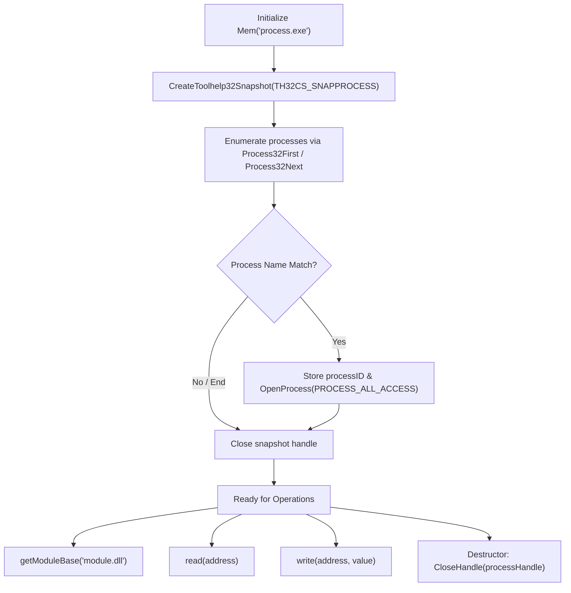

# mem.h — Windows Process Memory Utility

<div align="center">

[](#-requirements)
[](#-requirements)

*A lightweight, header-only C++ utility for locating Windows processes, retrieving module base addresses, and reading/writing process memory using the Win32 Toolhelp & Process APIs.*

---

</div>

## 📑 Table of Contents
- [📌 Overview](#-overview)
- [✨ Features](#-features)
- [🛠️ How It Works](#️-how-it-works)
  - [Workflow Lifecycle](#workflow-lifecycle)
- [📂 Project Structure](#-project-structure)
- [🧰 Requirements](#-requirements)
- [📚 Included Headers](#-included-headers)
- [⚙️ Windows API Functions Used](#️-windows-api-functions-used)
  - [1. CreateToolhelp32Snapshot](#1--createtoolhelp32snapshot)
  - [2. Process32First](#2--process32first)
  - [3. Process32Next](#3--process32next)
  - [4. OpenProcess](#4--openprocess)
  - [5. Module32First](#5--module32first)
  - [6. Module32Next](#6--module32next)
  - [7. ReadProcessMemory](#7--readprocessmemory)
  - [8. WriteProcessMemory](#8--writeprocessmemory)
  - [9. CloseHandle](#9--closehandle)
  - [10. Windows Data Structures](#10--windows-data-structures)
- [📋 API Quick Reference](#-api-quick-reference)
- [🧩 Class Reference](#-class-reference)
  - [🔹 Private Members](#-private-members)
  - [🔹 Public Methods](#-public-methods)
- [🚀 How to Use the Header](#-how-to-use-the-header)
- [💻 Complete Example](#-complete-example)
- [🏗️ Compilation with MSVC](#️-compilation-with-msvc)
- [⚠️ Important Limitations](#️-important-limitations)
- [🔒 Responsible Use](#-responsible-use)
- [🎯 Summary](#-summary)

---

## 📌 Overview

`mem.h` is a C++ class that wraps several Windows API functions into a clean, reusable interface for interacting with the memory space of running Windows processes.

Instead of writing verbose boilerplate and manually calling low-level Windows APIs for every operation, `Mem` encapsulates:
- 🔍 **Process Discovery** by executable name
- 📦 **Module Base Address Lookup**
- 📖 **Templated Memory Reading**
- ✏️ **Templated Memory Writing**
- 🧹 **RAII Handle Management**

---

## ✨ Features

- 🔍 **Process Discovery** — Automatically finds running processes by matching executable filename (`szExeFile`).
- 🔑 **Process Handle Management** — Requests process handles seamlessly with `OpenProcess`.
- 📦 **Module Enumeration** — Resolves module base addresses (`modBaseAddr`) for dynamic load-offset calculations.
- 📖 **Templated Memory Reading** — Read primitive types, structs, or pointers with concise `read<T>(address)` calls.
- ✏️ **Templated Memory Writing** — Write typed values directly into virtual memory via `write<T>(address, value)`.
- 🧹 **RAII Cleanup** — Automatically closes open process handles via destructor cleanup.
- 📄 **Header-Only Design** — Drop `mem.h` straight into any C++ project; no static libraries or separate DLL compilation needed.

---

## 🛠️ How It Works

The class leverages the Windows Tool Help library (`TlHelp32.h`) and Win32 process functions (`Windows.h`).

### Workflow Lifecycle



1. **Instantiation**: Instantiate a `Mem` object with the target executable name.
2. **Snapshot Creation**: Capture a snapshot of running processes (`TH32CS_SNAPPROCESS`).
3. **Iteration**: Iterate through active processes using `Process32First` and `Process32Next`.
4. **Acquisition**: Match the executable name, capture `th32ProcessID`, and call `OpenProcess`.
5. **Module Base Resolution**: Take a module snapshot (`TH32CS_SNAPMODULE | TH32CS_SNAPMODULE32`) to find the base virtual address.
6. **Read/Write Operations**: Perform virtual memory reads and writes via `ReadProcessMemory` and `WriteProcessMemory`.
7. **Destruction & RAII**: Destroy the `Mem` instance, triggering `CloseHandle` for automatic resource release.

---


## 🧰 Requirements

| Requirement | Details |
| :--- | :--- |
| **Operating System** | 🪟 Windows 10 / 11 / Server (x86 or x64) |
| **Language Standard** | ⚙️ C++17 or later |
| **Compiler** | 🧑‍💻 MSVC (Visual Studio 2017+), Clang-cl, or MinGW-w64 |
| **SDK** | 📚 Windows SDK (`Windows.h`, `TlHelp32.h`) |
| **Privileges** | 🔐 Appropriate execution permissions (administrator may be required depending on target process integrity level) |

---

## 📚 Included Headers

```cpp
#pragma once
#define WIN32_LEAN_AND_MEAN

#include <Windows.h>
#include <TlHelp32.h>
#include <cstdint>
#include <string_view>
```

| Header | Purpose |
| :--- | :--- |
| `<Windows.h>` | Provides Windows API types, constants (`HANDLE`, `DWORD`, `PROCESS_ALL_ACCESS`), and memory primitives. |
| `<TlHelp32.h>` | Provides process snapshot declarations (`CreateToolhelp32Snapshot`, `PROCESSENTRY32`, `MODULEENTRY32`). |
| `<cstdint>` | Provides fixed-width integer types such as `std::uintptr_t`. |
| `<string_view>` | Provides lightweight, non-allocating string references for process and module name comparisons. |

> [!NOTE]
> `#pragma once` prevents duplicate inclusions, and `#define WIN32_LEAN_AND_MEAN` strips rarely-used APIs (cryptography, networking, DDE) to dramatically speed up compilation times.

---

## ⚙️ Windows API Functions Used

### 1. 📸 `CreateToolhelp32Snapshot`

Takes a snapshot of specified processes, modules, or threads.

```cpp
HANDLE CreateToolhelp32Snapshot(
    DWORD dwFlags,
    DWORD th32ProcessID
);
```

#### Inputs
| Parameter | Description |
| :--- | :--- |
| `dwFlags` | Portions of the system to include (e.g., `TH32CS_SNAPPROCESS`, `TH32CS_SNAPMODULE`, `TH32CS_SNAPMODULE32`). |
| `th32ProcessID` | Target Process ID for module snapshots; pass `0` when querying system-wide processes. |

#### Return Value
- **Success**: Valid `HANDLE` to the snapshot.
- **Failure**: `INVALID_HANDLE_VALUE` (check with `GetLastError()`).

#### Usage in `Mem`:
```cpp
// Enumerate all system processes:
CreateToolhelp32Snapshot(TH32CS_SNAPPROCESS, 0);

// Enumerate 32-bit and 64-bit modules loaded by the target process:
CreateToolhelp32Snapshot(TH32CS_SNAPMODULE | TH32CS_SNAPMODULE32, processID);
```

---

### 2. 🔎 `Process32First`

Retrieves information about the first process encountered in a snapshot.

```cpp
BOOL Process32First(
    HANDLE hSnapshot,
    LPPROCESSENTRY32 lppe
);
```

#### Inputs
- `hSnapshot`: Handle to the snapshot returned by `CreateToolhelp32Snapshot`.
- `lppe`: Pointer to a `PROCESSENTRY32` structure.

#### Return Value
- **`TRUE` (`nonzero`)**: Success; buffer populated with process information.
- **`FALSE` (`0`)**: Failure or no matching entries found.

#### Usage in `Mem`:
```cpp
PROCESSENTRY32 entry{};
entry.dwSize = sizeof(PROCESSENTRY32);

Process32First(processSnapshot, &entry);
```

> [!IMPORTANT]
> The `dwSize` member of `PROCESSENTRY32` **must** be initialized to `sizeof(PROCESSENTRY32)` before calling `Process32First`. Failure to do so causes the API call to fail.

---

### 3. ➡️ `Process32Next`

Retrieves information about the next process recorded in a snapshot.

```cpp
BOOL Process32Next(
    HANDLE hSnapshot,
    LPPROCESSENTRY32 lppe
);
```

#### Inputs
- `hSnapshot`: Handle to the process snapshot.
- `lppe`: Pointer to the initialized `PROCESSENTRY32` structure.

#### Return Value
- **`TRUE` (`nonzero`)**: Next entry retrieved successfully.
- **`FALSE` (`0`)**: Enumeration complete or read error.

#### Usage in `Mem`:
```cpp
do {
    if (!processName.compare(entry.szExeFile)) {
        processID = entry.th32ProcessID;
        processHandle = ::OpenProcess(PROCESS_ALL_ACCESS, FALSE, processID);
        break;
    }
} while (Process32Next(processSnapshot, &entry));
```

---

### 4. 🔑 `OpenProcess`

Opens an existing local process object and returns a handle for manipulation.

```cpp
HANDLE OpenProcess(
    DWORD dwDesiredAccess,
    BOOL  bInheritHandle,
    DWORD dwProcessId
);
```

#### Inputs
| Parameter | Description |
| :--- | :--- |
| `dwDesiredAccess` | Requested access rights (e.g., `PROCESS_ALL_ACCESS`, `PROCESS_VM_READ`, `PROCESS_VM_WRITE`). |
| `bInheritHandle` | `TRUE` if child processes inherit this handle; `FALSE` otherwise. |
| `dwProcessId` | System identifier of the target process to open. |

#### Return Value
- **Success**: Open process `HANDLE`.
- **Failure**: `NULL` (inspect with `GetLastError()`).

#### Usage in `Mem`:
```cpp
processHandle = OpenProcess(
    PROCESS_ALL_ACCESS,
    FALSE,
    processID
);
```

> [!WARNING]
> Requesting `PROCESS_ALL_ACCESS` demands extensive privileges. If the target process is protected or runs under higher integrity, the call will fail with `ERROR_ACCESS_DENIED`. For read/write tasks, requesting `PROCESS_VM_READ | PROCESS_VM_WRITE | PROCESS_VM_OPERATION` is often preferred.

---

### 5. 📦 `Module32First`

Retrieves information about the first module associated with the target process.

```cpp
BOOL Module32First(
    HANDLE hSnapshot,
    LPMODULEENTRY32 lpme
);
```

#### Inputs
- `hSnapshot`: Module snapshot handle.
- `lpme`: Pointer to a `MODULEENTRY32` structure.

#### Return Value
- **`TRUE` (`nonzero`)**: Success.
- **`FALSE` (`0`)**: Failure or no modules available.

---

### 6. ➡️ `Module32Next`

Retrieves information about subsequent modules associated with the target process.

```cpp
BOOL Module32Next(
    HANDLE hSnapshot,
    LPMODULEENTRY32 lpme
);
```

#### Inputs
- `hSnapshot`: Module snapshot handle.
- `lpme`: Pointer to the `MODULEENTRY32` structure.

#### Return Value
- **`TRUE` (`nonzero`)**: Next module entry retrieved.
- **`FALSE` (`0`)**: Enumeration finished or failed.

#### Usage in `Mem`:
```cpp
do {
    if (!moduleName.compare(entry.szModule)) {
        moduleBase = reinterpret_cast<std::uintptr_t>(entry.modBaseAddr);
        break;
    }
} while (::Module32Next(moduleSnapshot, &entry));
```

---

### 7. 📖 `ReadProcessMemory`

Reads data from an area of memory in a specified process.

```cpp
BOOL ReadProcessMemory(
    HANDLE      hProcess,
    LPCVOID     lpBaseAddress,
    LPVOID      lpBuffer,
    SIZE_T      nSize,
    SIZE_T*     lpNumberOfBytesRead
);
```

#### Inputs
| Parameter | Description |
| :--- | :--- |
| `hProcess` | Handle to the process whose memory is read. |
| `lpBaseAddress` | Base virtual address in the target process. |
| `lpBuffer` | Pointer to local buffer receiving copied data. |
| `nSize` | Total number of bytes to read. |
| `lpNumberOfBytesRead` | Optional pointer receiving the number of bytes transferred. |

#### Return Value
- **`TRUE` (`nonzero`)**: Success.
- **`FALSE` (`0`)**: Failed (e.g., unmapped memory, insufficient permissions).

#### Usage in `Mem`:
```cpp
template<typename T>
constexpr const T read(const std::uintptr_t& address) const noexcept {
    T value = {};
    ReadProcessMemory(
        processHandle,
        reinterpret_cast<LPCVOID>(address),
        &value,
        sizeof(T),
        NULL
    );
    return value;
}
```

Example usage:
```cpp
int health = mem.read<int>(healthAddress);
```

---

### 8. ✏️ `WriteProcessMemory`

Writes data to an area of memory in a specified process.

```cpp
BOOL WriteProcessMemory(
    HANDLE      hProcess,
    LPVOID      lpBaseAddress,
    LPCVOID     lpBuffer,
    SIZE_T      nSize,
    SIZE_T*     lpNumberOfBytesWritten
);
```

#### Inputs
| Parameter | Description |
| :--- | :--- |
| `hProcess` | Handle to the process whose memory is modified. |
| `lpBaseAddress` | Destination virtual address in the target process. |
| `lpBuffer` | Pointer to local buffer containing data to write. |
| `nSize` | Total number of bytes to write. |
| `lpNumberOfBytesWritten` | Optional pointer receiving the number of bytes written. |

#### Return Value
- **`TRUE` (`nonzero`)**: Success.
- **`FALSE` (`0`)**: Failed.

#### Usage in `Mem`:
```cpp
template<typename T>
constexpr void write(const std::uintptr_t& address, const T& value) const noexcept {
    WriteProcessMemory(
        processHandle,
        reinterpret_cast<LPVOID>(address),
        &value,
        sizeof(T),
        NULL
    );
}
```

Example usage:
```cpp
mem.write<int>(healthAddress, 100);
```

---

### 9. 🧹 `CloseHandle`

Closes an open object handle, freeing the associated system resource.

```cpp
BOOL CloseHandle(HANDLE hObject);
```

#### Return Value
- **`TRUE` (`nonzero`)**: Handle closed successfully.
- **`FALSE` (`0`)**: Failed.

#### RAII in `Mem`:
```cpp
~Mem() {
    if (processHandle) {
        CloseHandle(processHandle);
    }
}
```

> [!TIP]
> Snapshot handles created with `CreateToolhelp32Snapshot` must also be released with `CloseHandle` once enumeration concludes to prevent resource leaks.

---

### 10. 🧱 Windows Data Structures

#### `PROCESSENTRY32`
Contains process descriptors populated during process enumeration:
- `dwSize`: Must be set to `sizeof(PROCESSENTRY32)`.
- `th32ProcessID`: Process identifier (PID).
- `szExeFile`: Executable filename (e.g., `notepad.exe`).

#### `MODULEENTRY32`
Contains module descriptors populated during module enumeration:
- `dwSize`: Must be set to `sizeof(MODULEENTRY32)`.
- `szModule`: Module filename (e.g., `kernel32.dll`).
- `modBaseAddr`: Base address of module in process context (`BYTE*`).
- `modBaseSize`: Size of module in bytes.

---

## 📋 API Quick Reference

| Windows API Function | Primary Purpose | Return Type | Header |
| :--- | :--- | :---: | :---: |
| [`CreateToolhelp32Snapshot`](#1--createtoolhelp32snapshot) | Create process or module snapshot | `HANDLE` | `<TlHelp32.h>` |
| [`Process32First`](#2--process32first) | Get first process in snapshot | `BOOL` | `<TlHelp32.h>` |
| [`Process32Next`](#3--process32next) | Enumerate next process in snapshot | `BOOL` | `<TlHelp32.h>` |
| [`OpenProcess`](#4--openprocess) | Obtain process handle | `HANDLE` | `<Windows.h>` |
| [`Module32First`](#5--module32first) | Get first module in snapshot | `BOOL` | `<TlHelp32.h>` |
| [`Module32Next`](#6--module32next) | Enumerate next module in snapshot | `BOOL` | `<TlHelp32.h>` |
| [`ReadProcessMemory`](#7--readprocessmemory) | Read virtual memory bytes | `BOOL` | `<Windows.h>` |
| [`WriteProcessMemory`](#8--writeprocessmemory) | Write virtual memory bytes | `BOOL` | `<Windows.h>` |
| [`CloseHandle`](#9--closehandle) | Close kernel/snapshot handle | `BOOL` | `<Windows.h>` |

---

## 🧩 Class Reference

### 🔹 Private Members

| Member | Type | Default | Description |
| :--- | :---: | :---: | :--- |
| `processID` | `std::uintptr_t` | `0` | Stores target process ID (PID) if discovered. |
| `processHandle` | `void*` (`HANDLE`) | `nullptr` | Stores open process handle from `OpenProcess`. |

---

### 🔹 Public Methods

#### `Mem(const std::string_view processName) noexcept`
- **Description**: Constructor that iterates system processes to find `processName`, acquires its PID, and opens a handle.
- **Parameters**: `processName` — String view representing the target executable (e.g. `"notepad.exe"`).

```cpp
Mem mem("notepad.exe");
```

#### `const std::uintptr_t getModuleBase(const std::string_view moduleName) const noexcept`
- **Description**: Finds the base virtual address of a loaded module within the target process.
- **Parameters**: `moduleName` — Target module name (e.g. `"notepad.exe"`, `"user32.dll"`).
- **Returns**: `std::uintptr_t` base address, or `0` if not found / on failure.

```cpp
std::uintptr_t base = mem.getModuleBase("notepad.exe");
```

#### `template<typename T> constexpr const T read(const std::uintptr_t& address) const noexcept`
- **Description**: Reads a typed value from target process memory at `address`.
- **Template Parameter**: `T` — Data type to read (primitive, struct, pointer).
- **Parameters**: `address` — Target memory address.
- **Returns**: The read value of type `T` (or default initialized `{}` if read fails).

```cpp
int ammo = mem.read<int>(ammoAddress);
float speed = mem.read<float>(speedAddress);
```

#### `template<typename T> constexpr void write(const std::uintptr_t& address, const T& value) const noexcept`
- **Description**: Writes typed `value` to target memory at `address`.
- **Parameters**:
  - `address` — Target memory destination address.
  - `value` — Value of type `T` to write.

```cpp
mem.write<int>(ammoAddress, 999);
mem.write<float>(speedAddress, 15.0f);
```

#### `uintptr_t getProcessID()`
- **Description**: Returns the captured process ID.
- **Returns**: `std::uintptr_t` PID, or `0` if process was not found.

```cpp
std::uintptr_t pid = mem.getProcessID();
```

---

## 🚀 How to Use the Header

### Step 1: Include in Your Code
Copy `mem.h` to your source directory and include it:
```cpp
#include "mem.h"
```

### Step 2: Instantiate Target
```cpp
Mem mem("target_app.exe");
```

### Step 3: Validate Process ID
```cpp
std::uintptr_t pid = mem.getProcessID();
if (pid == 0) {
    std::cerr << "Process not found!\n";
    return 1;
}
```

### Step 4: Resolve Base Address & Read/Write Memory
```cpp
std::uintptr_t base = mem.getModuleBase("target_app.exe");
std::uintptr_t targetVar = base + 0x123450; // offset

int currentVal = mem.read<int>(targetVar);
mem.write<int>(targetVar, currentVal + 10);
```

---

## 💻 Complete Example

```cpp
#include <iostream>
#include <iomanip>
#include "mem.h"

int main() {
    // 1. Attach to target process
    Mem mem("Notepad.exe");

    const std::uintptr_t pid = mem.getProcessID();
    if (pid == 0) {
        std::cerr << "[!] Target process was not found.\n";
        return 1;
    }

    std::cout << "[+] Found Process ID: " << pid << '\n';

    // 2. Query module base address
    const std::uintptr_t moduleBase = mem.getModuleBase("Notepad.exe");
    if (moduleBase == 0) {
        std::cerr << "[!] Module not found or snapshot creation failed.\n";
        return 1;
    }

    std::cout << "[+] Module base address: 0x" 
              << std::hex << std::uppercase << moduleBase << '\n';

    // 3. Example memory read & write (with verified valid target offset)
    /*
    const std::uintptr_t testAddress = moduleBase + 0x1000;
    int value = mem.read<int>(testAddress);
    std::cout << "[+] Read value: " << std::dec << value << '\n';

    mem.write<int>(testAddress, 42);
    std::cout << "[+] Wrote new value: 42\n";
    */

    return 0;
}
```

---

## 🏗️ Compilation with MSVC

Open **x64 Native Tools Command Prompt for VS** and run:

```bash
# Build as 64-bit release executable with C++17
cl /std:c++17 /EHsc /O2 src/main.cpp /Fe:MemoryExample.exe
```

Or open `Memory.vcxproj` in **Visual Studio**, select your target platform (**x64** or **x86** matching target process architecture), and build (`Ctrl + Shift + B`).

---

## ⚠️ Important Limitations

Before deploying this utility in production or complex toolchains, keep the following limitations in mind:

1. **❗ Memory Operations Do Not Report Failures**  
   `ReadProcessMemory` and `WriteProcessMemory` return a `BOOL`, but the template methods currently discard the return value. Failed reads quietly return `{}`.
2. **🔐 Process Handle Validation Is Missing**  
   The constructor stores `processID` regardless of whether `OpenProcess` succeeded. `getProcessID()` returning nonzero does not guarantee valid process handle access.
3. **🛡️ Broad Access Permissions Requested**  
   `PROCESS_ALL_ACCESS` requests every possible permission. If targeting elevated or protected processes, Windows will refuse the request with access denied.
4. **🧹 Copy Semantics & Double-Close Hazard**  
   The class lacks a custom copy constructor or deleted copy operators (`Mem(const Mem&) = delete`). Copying a `Mem` instance will result in both copies attempting to call `CloseHandle` on the same handle.
5. **🧩 Architecture Differences (x86 vs x64)**  
   A 32-bit process inspecting a 64-bit process has limitations regarding module enumeration and address boundaries. Build your utility to match the bitness of your target process.
6. **🧱 Non-Trivial Types in Templates**  
   `read<T>` and `write<T>` perform raw byte copies. They should only be used with trivially copyable types (`int`, `float`, plain structs) and will not automatically follow pointers or deep-copy standard containers like `std::string` or `std::vector`.
7. **🧭 Pointer Offsets & Multi-Level Pointers**  
   Module base addresses represent memory start points; target data usually requires manual resolution of pointer offsets or pointer chains.
8. **🪟 `noexcept` Does Not Guard Win32 API Errors**  
   The `noexcept` specifier only declares that C++ exceptions will not be thrown; it does not protect against Win32 runtime errors or page faults.

---

## 🔒 Responsible Use

> [!CAUTION]
> **Educational and Authorized Use Only**  
> Inter-process memory inspection and modification should only be performed on applications that you own, have created, or have explicit authorization to inspect and debug. Always ensure compliance with relevant software licenses and terms of service.

---

## 🎯 Summary

| Capability | Method |
| :--- | :--- |
| **Find & Open Process** | `Mem(processName)` |
| **Retrieve Module Base** | `getModuleBase(moduleName)` |
| **Read Typed Value** | `read<T>(address)` |
| **Write Typed Value** | `write<T>(address, value)` |
| **Retrieve Process ID** | `getProcessID()` |
| **Release Handle (RAII)** | `~Mem()` |

---

<div align="center">
<sub>Built with standard C++17 & Win32 API</sub>
</div>
